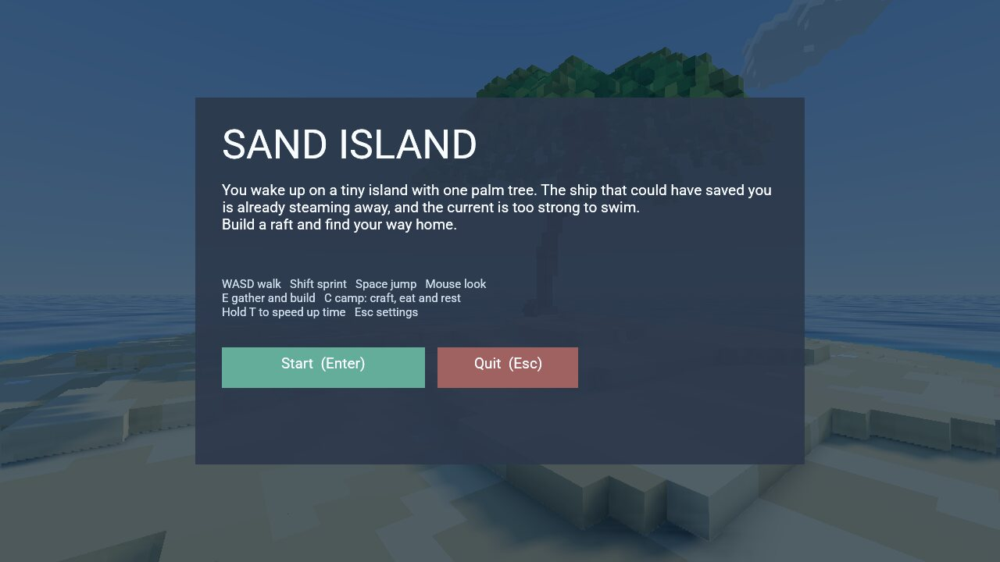
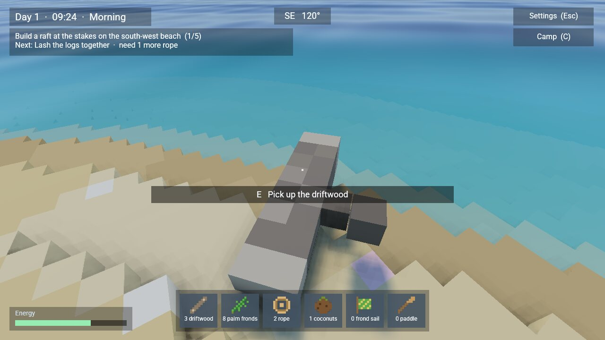
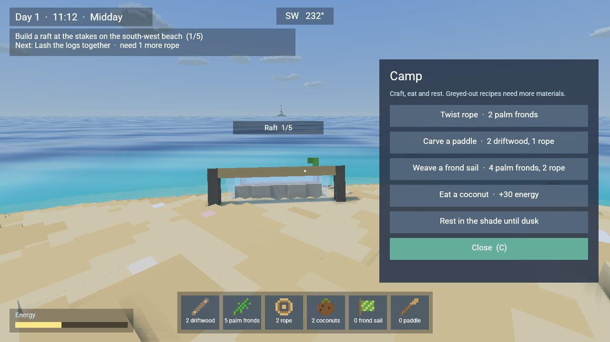
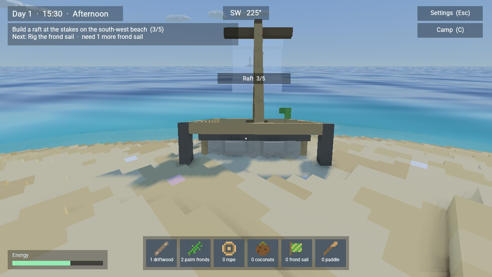
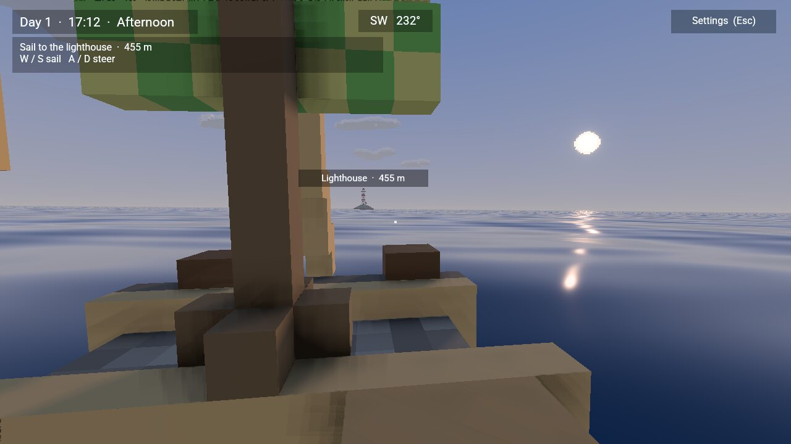
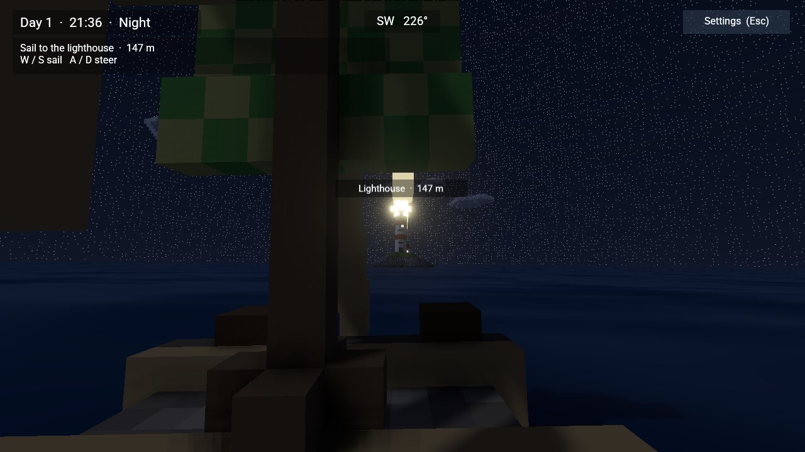
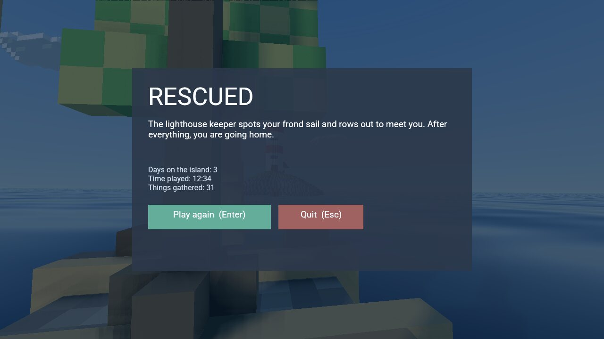

# Sand Island

A first-person voxel survival game. You wake up on a tiny sand island with one palm
tree in an endless ocean. The ship that could have saved you is already steaming away,
and the current is too strong to swim. Far to the south-west stands a lighthouse.
Gather what washes up, craft at your camp, build a raft and sail for the light.

Everything is voxels except the ocean. Days pass at eight game seconds per real second.

| | |
| --- | --- |
|  |  |
|  |  |
|  |  |

```sh
cargo run --release --locked -p bozzard-player -- --scene examples/sand-island/scenes/island.json
cargo run --release --locked -p bozzard-editor-app -- --scene examples/sand-island/scenes/island.json
```

## How to play

1. **Gather.** Look at something and press **E**:
   - **Driftwood** lies on the beach, and a new piece washes up every half minute or so.
   - **The palm** gives two fronds per pull. Shaking it sometimes drops a coconut, and it grows new fronds over time.
   - **Coconuts** can be picked up from the sand.
2. **Craft at camp.** Press **C** to:
   - twist rope (2 fronds);
   - carve a paddle (2 driftwood, 1 rope);
   - weave a frond sail (4 fronds, 2 rope);
   - eat a coconut (+30 energy);
   - rest in the shade until dusk or dawn.
3. **Build the raft** at the stakes on the south-west beach, one stage per **E**. A translucent preview shows the next stage.

   | Stage | Needs |
   | --- | --- |
   | Lay the hull logs | 4 driftwood |
   | Lash the logs together | 3 rope |
   | Raise the mast | 2 driftwood, 1 rope |
   | Rig the frond sail | 1 frond sail |
   | Stow the paddle and coconuts | 1 paddle, 2 coconuts |

4. **Find the lighthouse.** Look out to the south-west for a moment, or wait for nightfall, when its lamp and turning beam show the way. A label marks it once you've seen it.
5. **Launch and sail.** Press **E** twice at the finished raft (there's no coming back). **W/S** sail and **A/D** steer, past the current to the lighthouse.

Walking, sprinting and swimming use energy. Below 20 you slow down, and at zero you collapse and wake up the next morning in the palm's shade. All together the island has 8 driftwood, 18 fronds and 2 coconuts' worth of raft in it, and a playthrough takes about ten minutes.

| Action | Control |
| --- | --- |
| Look / walk / sprint / jump | Mouse / WASD / hold Shift / Space |
| Gather, build, launch | E |
| Camp: craft, eat, rest | C (C or Esc closes it) |
| Speed time up | Hold T (720 game seconds per real second; a day takes two minutes) |
| Settings | Esc, or the **Settings** button; Esc again resumes |

Walking eases in and out. The eye dips on landing and bobs as you walk, and the view
widens a little while you sprint. The sea slows you down as you wade. Past chest
depth you swim, and the current turns you back before the open sea.

## HUD and settings

The HUD shows:
- the day and clock, a compass, and the current objective with what it still needs;
- what E would do, pickups and messages;
- your energy and the inventory, with pixel-art icons;
- labels floating over the raft site and the lighthouse.

The settings menu pauses game time:

| Mouse and view | Graphics |
| --- | --- |
| Mouse sensitivity (0.1–3×) | Quality: Low / Medium / High |
| Invert mouse Y | View distance: Near / Medium / Far |
| Field of view (60–110°) | Shadows, Clouds, Bloom |
| Head bobbing | VSync, Window: Windowed / Borderless / Fullscreen |
| | Show FPS |


Quality, VSync and window mode are [player settings](../../docs/player-settings.md),
so they apply in the native player and are saved for the next run. The other options
last for the current session.

| Morning | Sunset |
| --- | --- |
|  |  |
| **The ship, up close** | **Rescued** |
|  |  |

## How the game is built

`tools/gen_island.py` generates everything that comes from geometry, using only
Python's standard library:
- the meshes and the inventory icon atlas;
- the ocean material;
- the scene, with its HUD and menus;
- `scripts/island.rhai`, a library holding the island's shape and the game's layout
  (raft site, launch point, beach spawn spots, lighthouse), recipe tables and tuning.

The gameplay scripts beside the library are written by hand:

| Script | Role |
| --- | --- |
| `game.rhai` | Moves the game through its modes (title → island → launch → raft → ended). Handles what you aim at, the inventory, the camp, energy, the rest and collapse fades, spawning driftwood and coconuts, raft stages, spotting the lighthouse and the ending |
| `player.rhai` | Walking on the island's height function, and sailing the raft |
| `hud.rhai` | The settings menu, and drawing what the game decided |
| `world.rhai` | The day/night cycle, the sun and moon, and the lighthouse lamp and beam at night |
| `ship.rhai`, `smoke.rhai`, `cloud.rhai`, `palm.rhai` | The ship and its smoke, drifting clouds, and the swaying (and shaken) palm |

| Content | Representation |
| --- | --- |
| Island and seafloor | `island.gltf`: 0.25 m voxel columns cut from one height function, greedy-meshed into about 27k quads, one primitive per colour |
| Palm, driftwood, coconuts | Voxel glTFs. Pickups that aren't on the beach are parked under the island until the game places them |
| Raft | Five stage meshes plus a translucent preview of each, built at the stakes and launched down the beach |
| Lighthouse islet | 0.5 m voxels: a rock and grass heightfield, a striped tower with gallery and lantern, the keeper's cottage and a dock. The lamp, its turning beam and the cottage windows light up at night. The lamp flares when the beam sweeps toward you |
| Ship and smoke | `ship.gltf` in 1 m voxels with night navigation lights. Its 40 smoke puffs are placed from their age alone, so the trail stays behind the moving ship |
| Sky | A voxel sun (orange near the horizon), a voxel moon and 16 drifting voxel clouds over the engine's sky gradient and stars |
| Ocean | A 20 km translucent plane with a shader graph: wave normals from five moving sines, and a turquoise lagoon around the island that fades to deep blue |

Movement does not use the physics engine. `player.rhai` walks on `island::ground`,
the height function the voxels were cut from, so 0.25 m voxel terraces feel like a
smooth slope. The palm trunk is a post to walk around.

The clock is kept as whole game seconds plus a fraction, so the 8× rate stays exact
over a long session. One sun light follows the sun or the moon in tenths of a degree,
so shadow edges don't crawl. The scene sets a 32 m
[sun shadow distance](../../docs/lighting.md#sun-shadow-distance), so shadows stay
sharp with the ship and the lighthouse far out at sea.

Regenerate after editing the generator; `--check` verifies the committed files:

```sh
python3 tools/gen_island.py
python3 tools/gen_island.py --check
python3 -m unittest tools/test_gen_island.py
cargo test -p bozzard-runtime --test sand_island
```

The Python tests check that every object, variable and asset the scripts name exists,
and that the island can supply everything the raft needs. The Rust tests play the scene
headless:
- walking, jumping, the palm trunk and the swimming limit;
- the 8× clock and the ship;
- the settings menu, and that Esc always belongs to a button;
- gathering, crafting, resting and collapsing;
- the whole voyage, from the first log to the rescue and Play again.

To take a screenshot without opening a window, run
`bozzard-player --scene examples/sand-island/scenes/island.json --capture shot.ppm --capture-ticks 120`.
