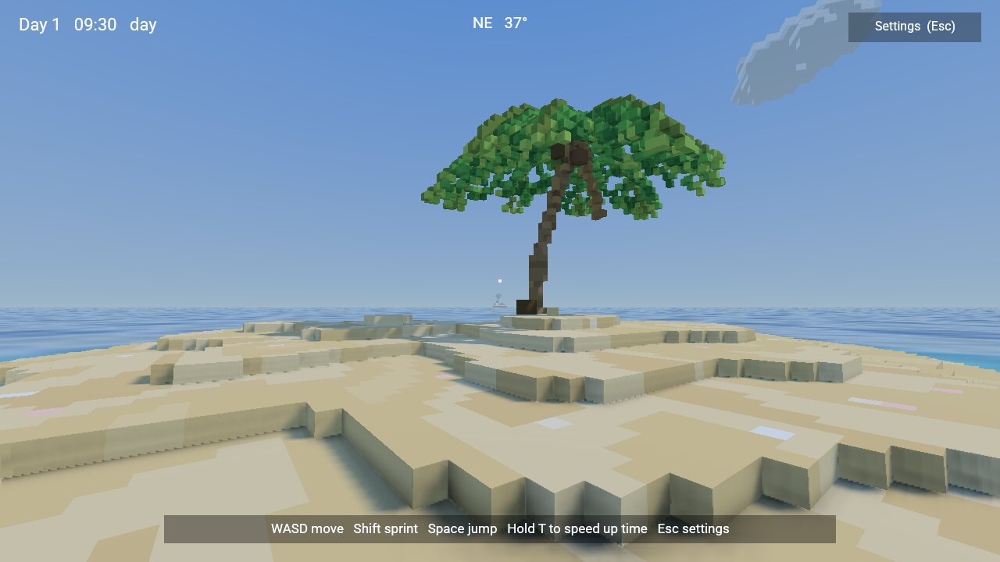
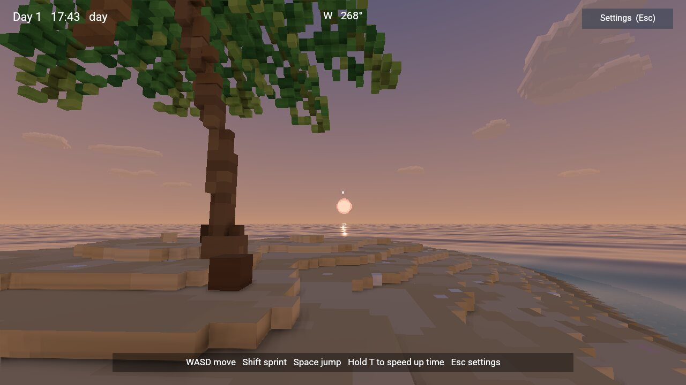
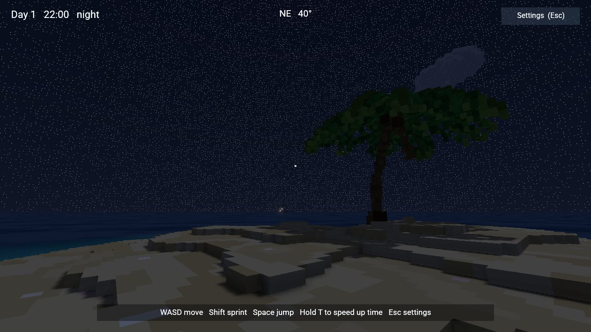
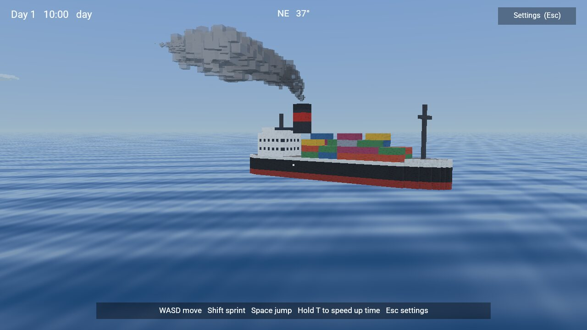
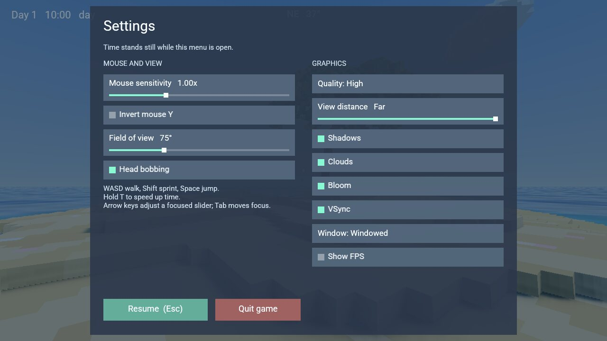

# Sand Island

A first-person castaway scene. You are stranded on a tiny sand island with one palm
tree and an endless ocean. Far out to sea, a steamship trails smoke as it sails away.
Everything is voxels except the ocean. Days pass at eight game seconds per real second.

| Morning | Sunset |
| --- | --- |
|  |  |
| **Night** | **The ship, up close** |
|  |  |

```sh
cargo run --release --locked -p bozzard-player -- --scene examples/sand-island/scenes/island.json
cargo run --release --locked -p bozzard-editor-app -- --scene examples/sand-island/scenes/island.json
```

## Controls

| Action | Control |
| --- | --- |
| Look | Mouse |
| Walk / sprint | WASD / hold Shift |
| Jump | Space |
| Speed time up | Hold T (720 game seconds per real second; a day takes two minutes) |
| Settings | Esc, or the **Settings** button; Esc again resumes |

Walking eases in and out. The eye dips on landing and bobs as you walk, and the view
widens a little while you sprint. The sea slows you down as you wade. Past chest
depth you swim, and the current turns you back before the open sea.

## HUD and settings

The HUD shows the day and clock, a compass, a crosshair, messages and a controls hint.
The settings menu pauses game time and covers these options:

| Mouse and view | Graphics |
| --- | --- |
| Mouse sensitivity (0.1–3×) | Quality: Low / Medium / High |
| Invert mouse Y | View distance: Near / Medium / Far |
| Field of view (60–110°) | Shadows, Clouds, Bloom |
| Head bobbing | VSync, Window: Windowed / Borderless / Fullscreen |
| | Show FPS |



Quality, VSync and window mode are [player settings](../../docs/player-settings.md),
so they apply in the native player and are saved for the next run. The other options
last for the current session.

## How the scene is built

`tools/gen_island.py` generates the whole example: meshes, the ocean material, the
scripts, the HUD and the scene. It uses only Python's standard library.

| Content | Representation |
| --- | --- |
| Island and seafloor | `island.gltf`: 0.25 m voxel columns cut from one height function, greedy-meshed into about 27k quads, one primitive per colour. Dry, damp and underwater sand get their own colours, with ripples and a few shells |
| Palm tree | `palm-trunk.gltf` (a leaning, ringed trunk) and `palm-crown.gltf` (ten fronds, coconuts and two dead fronds); `scripts/palm.rhai` sways the crown |
| Ship | `ship.gltf` in 1 m voxels: hull, bridge, funnel, containers and masts. `ship-lights.gltf` holds its emissive navigation lights and windows, shown only at night |
| Smoke | 40 translucent voxel puffs. `scripts/smoke.rhai` places each one from its age alone, so the trail stays behind the moving ship without stored state |
| Sky | A voxel sun (with an orange low-sun mesh for dawn and dusk), a voxel moon and 16 drifting voxel clouds. The sky gradient and the stars are the engine's environment |
| Ocean | A 20 km translucent plane with a shader graph: wave normals from five moving sines, and a turquoise lagoon around the island that fades to deep blue |

Movement does not use the physics engine. `scripts/player.rhai` walks on
`island::ground`, the height function the voxels were cut from, so 0.25 m voxel
terraces feel like a smooth slope. The palm trunk is a post to walk around.

`scripts/world.rhai` keeps the clock as whole game seconds plus a fraction, so the
8× rate stays exact over a long session. It moves the scene's single sun light
between the sun and the moon with `set_sun_direction`. It also blends the sky, fog,
ambient light and stars by the sun's height. The scene sets a 32 m
[sun shadow distance](../../docs/lighting.md#sun-shadow-distance), so shadows stay
sharp even with the ship more than a kilometre away.

Regenerate after editing the generator; `--check` verifies the committed files:

```sh
python3 tools/gen_island.py
python3 tools/gen_island.py --check
python3 -m unittest tools/test_gen_island.py
cargo test -p bozzard-runtime --test sand_island
```

The Rust tests play the scene headless. They check walking, sprinting, jumping, the
palm trunk, the swimming limit, the 8× clock, the ship and its smoke, and the settings
menu.

To take a screenshot without opening a window, run
`bozzard-player --scene examples/sand-island/scenes/island.json --capture shot.ppm --capture-ticks 120`.
